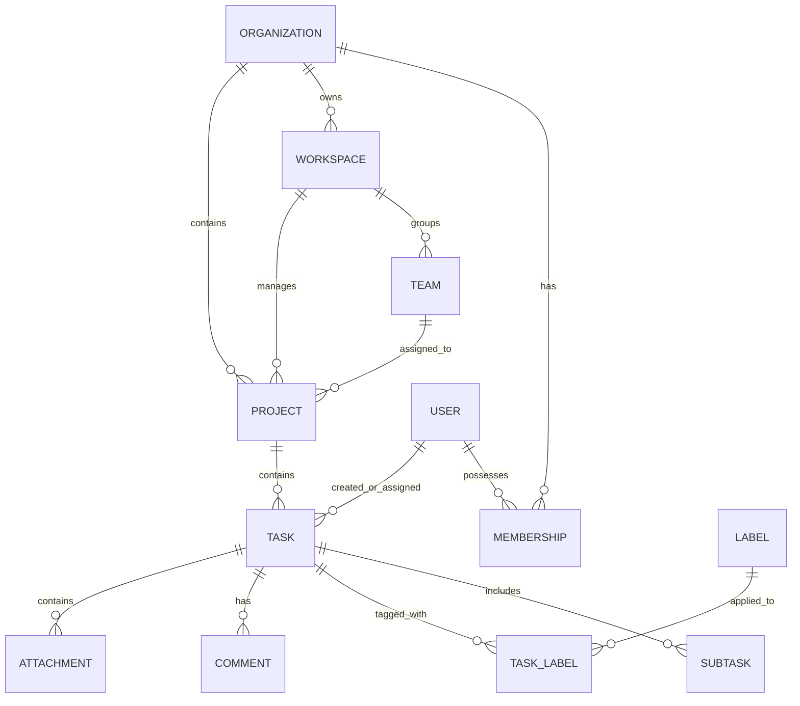

# Qveto Data Entity Relationships & Architecture

**Document Owner:** Member 5 (QA & Docs) based on Member 1 (Database/Migrations) ER model  

---

### 1. High-Level Entity Relationship Diagram

---

### 2. Entity Descriptions and Cardinality

1. **Organization (Tenant Root):**
   - The absolute security boundary. Every database query enforces `WHERE org_id = :current_user_org_id`.
   - Has many Memberships, Workspaces, Projects, and Users.

2. **User & Membership:**
   - A single User belongs to an Organization via a Membership record.
   - Membership carries the role enum: `['OWNER', 'MANAGER', 'EMPLOYEE']`.

3. **Workspace & Team:**
   - Workspaces partition business divisions within an organization (e.g., Engineering, Marketing).
   - Teams group users across workspaces for collective task assignment and filtering.

4. **Project:**
   - Belongs to an Organization and Workspace.
   - Maintains a list of member IDs (`project_members`).
   - Project statuses: `ACTIVE`, `COMPLETED`, `ARCHIVED`.

5. **Task:**
   - Belongs to a Project and inherits the `org_id` for defense-in-depth isolation.
   - Contains Kanban status (`TODO`, `IN_PROGRESS`, `REVIEW`, `DONE`), priority (`LOW`, `MEDIUM`, `HIGH`, `URGENT`), `order_index`, `due_date`, and `completed_at`.

6. **Subtask:**
   - Child entity of Task.
   - Contains `title` and `is_completed` boolean flag. Aggregate progress is computed as $(\text{completed} / \text{total}) \times 100\%$, returning 0% when no subtasks exist.

7. **Labels / Tags:**
   - Categorization labels (e.g. `frontend`, `bug`, `backend`) normalized to lowercase for resilient querying.
