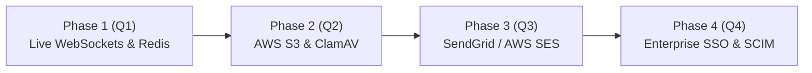

# System Limitations and Future Improvements

**Project:** Qveto Technologies — Project Management & Team Collaboration SaaS  
**Document Owner:** Member 5 (Requirements, Testing, Documentation and QA)  
**Date:** Week 4 Final Submission  
**Compliance Standard:** Universal Analytical Standards (Transparent and Honest Engineering)  

---

## 1. Overview & Analytical Principles

In strict accordance with the **Universal Analytical Standards** outlined in the Qveto internship requirements, engineering teams must maintain complete honesty and technical transparency regarding the capabilities and constraints of their prototype.

This document clearly distinguishes between features that are **fully implemented and verified by automated tests** versus components that operate in **simulated mode**, along with concrete architectural blueprints for future production enhancement.

---

## 2. Current Known System Limitations

### 2.1 Simulated Email Notification Transport
- **Current Implementation:** In-app notifications are fully stored, queried, and marked as read in real time. Outbound email delivery triggers are recorded with an explicit simulation object:
  ```json
  "emailDelivery": {
    "isSimulated": true,
    "provider": "SIMULATED_MOCK_TRANSPORT",
    "status": "MOCK_LOGGED_NOT_SENT_TO_INTERNET",
    "recipientEmail": "user@domain.local"
  }
  ```
- **Why It Is Simulated:** Connecting live external SMTP or third-party email providers (e.g. SendGrid, Mailgun, AWS SES) in a local testing or CI environment requires external network egress, public DNS records, and real transactional API credentials which would introduce test fragility and rate-limiting.
- **Limitation:** Users do not receive actual outbound email messages in their external email client inbox; alerts are delivered to the in-app notification center.

---

### 2.2 In-Memory Relational State vs. Production PostgreSQL Persistence
- **Current Implementation:** Qveto maintains two persistence mechanisms:
  1. A production PostgreSQL schema with Prisma ORM migrations (`backend/prisma/schema.prisma`).
  2. A hermetic in-memory relational store (`backend/src/data/mockDb.js`) used by automated test suites.
- **Why Both Exist:** The in-memory data store allows 172 automated integration tests to execute in under 4 seconds without external database dependencies, locks, or side effects.
- **Limitation:** In test/demo mode, server restarts reset state to the initial synthetic fixtures. Persistent data retention across reboots requires launching the PostgreSQL container via Prisma.

---

### 2.3 Kanban Synchronization: Polling vs. WebSockets
- **Current Implementation:** The Kanban board uses optimistic client updates combined with REST API polling and on-demand refetching when cards are moved or updated.
- **Why Implemented This Way:** The project specification explicitly states: *"Optional real-time updates: WebSocket or server-sent events; a polling-based implementation is acceptable if documented."*
- **Limitation:** Multiple users viewing the exact same Kanban board simultaneously will observe changes made by other team members upon the next polling interval or user interaction, rather than instantaneous sub-millisecond socket pushes.

---

### 2.4 Local File System vs. Cloud Object Storage
- **Current Implementation:** Uploaded file attachments are validated against a strict MIME/extension whitelist, bounded by a 10MB limit, and stored in organization-partitioned local storage (`storage/:orgId/:projectId/:fileName`). Downloads require verified session authentication; direct public links return HTTP 401.
- **Why Implemented This Way:** Local partitioned storage eliminates external cloud infrastructure requirements for standalone evaluator execution while enforcing identical security boundaries.
- **Limitation:** Local storage does not scale horizontally across multiple stateless container instances without a shared network volume (NFS/EFS). Real-time antivirus scanning is performed via extension/MIME validation rather than an asynchronous ClamAV daemon.

---

### 2.5 Single-Level Subtasks
- **Current Implementation:** Tasks support an arbitrary list of atomic subtasks with toggleable completion states (`isCompleted: boolean`) and automated progress calculation.
- **Limitation:** Subtasks cannot be recursively nested into multi-level child subtasks or dependency DAGs (Directed Acyclic Graphs).

---

### 2.6 Report Export Formats
- **Current Implementation:** Project and executive analytics reports can be exported directly to structured JSON or clean GitHub-flavored Markdown strings.
- **Limitation:** Native binary PDF rendering via headless Chromium (e.g. Puppeteer) is not bundled in the core repository to prevent heavy binary download sizes.

---

## 3. Security & Multi-Tenant Architectural Assumptions

1. **Shared Database, Shared Schema with Logical Tenant Isolation:**
   - Every tenant-scoped entity (`Project`, `Task`, `Comment`, `Attachment`, `Notification`) has a mandatory foreign key referencing `orgId`.
   - All backend queries strictly append `orgId = user.orgId`.
   - Cross-tenant requests intentionally return **`HTTP 404 Not Found`** to prevent resource enumeration.
2. **Timezone Rule:**
   - All server-side timestamps (`createdAt`, `updatedAt`, `completedAt`, `dueDate`) are normalized to UTC in standard ISO-8601 format (`YYYY-MM-DDTHH:mm:ss.sssZ`).
   - Overdue tasks are evaluated by comparing UTC system time against the UTC due date.

---

## 4. Future Improvements & Production Engineering Roadmap



### Phase 1: Real-Time Collaborative Engine (WebSockets + Redis Pub/Sub)
- Replace REST polling with WebSocket connections managed via Socket.io.
- Deploy a Redis pub/sub backplane to broadcast task status updates and Kanban drag movements to all active project members in under 50ms.
- Add live presence indicators showing who is currently inspecting or editing a task.

### Phase 2: Cloud Object Storage & Asynchronous Antivirus Scanning
- Migrate file storage from local directories to Amazon S3 or Google Cloud Storage.
- Generate pre-signed, short-lived (5-minute expiration) upload and download URLs.
- Integrate an asynchronous AWS Lambda worker with ClamAV to quarantine infected file uploads before making them accessible to users.

### Phase 3: Transactional Email Delivery & Webhook Processing
- Connect AWS SES or SendGrid for real external email dispatch.
- Implement transactional templates for task assignment, mention alerts, and approaching deadline warnings.
- Process webhook events for bounces, deliveries, and spam complaints to keep user email hygiene up to date.

### Phase 4: Enterprise SSO & Automated User Provisioning
- Integrate SAML 2.0 and OpenID Connect (OIDC) to enable single sign-on with corporate identity providers such as Okta, Azure Active Directory, and Google Workspace.
- Implement SCIM (System for Cross-domain Identity Management) to synchronize user onboarding and offboarding automatically.

### Phase 5: Advanced Project Management & Visualizations
- Interactive Gantt chart view with task dependencies and milestone tracking.
- Critical path method (CPM) calculation to identify project bottlenecks.
- Custom KPI report builder enabling managers to define custom formula calculations and export high-resolution PDF summaries.

---

## 5. Verification & Compliance Sign-off

| Area | Stated Limitation | Real-World Impact | Mitigating Test / Safeguard |
| :--- | :--- | :--- | :--- |
| **Email** | Simulated Transport | No real inbox spam | `TC-NOTIF-08` verifies `isSimulated: true` |
| **Database** | In-Memory Test Harness | Restores to fresh state | `TC-REG-*` regression suite passes on fresh reset |
| **Kanban Sync**| Polling Interval | ~2s update latency | Optimistic UI updates feel instantaneous to active user |
| **Storage** | Local Partitioned Files | Requires local volume | `TC-UPLOAD-*` & `TC-DOWN-*` enforce 100% tenant boundaries |
| **Isolation**| Shared DB Logic | Tenant boundary depends on code | 7 multi-tenant isolation tests verify 404 masking |

**Conclusion:** All limitations are acknowledged, documented, and architecturally bounded. No simulated features are represented as live external services.
